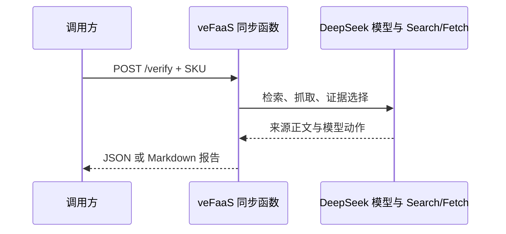

# veFaaS 同步核验部署

一个同步 Webserver 函数完成核验并直接返回 JSON 或 Markdown 报告。调用方负责保存收到的结果；服务没有 TOS、数据库、结果查询函数和异步回调依赖。



## 账号与访问

使用个人账号登录 `vefaas login --sso`，用 `vefaas whoami -o json` 核对账号。首次使用需在控制台开通函数服务。

初始部署使用平台 IAM 鉴权的 `TestInvoke`，另要求服务 token，不绑定公网 APIG。没有网关的账号也能验证云端完整流程。复制 `deployment.example.json` 为 `deployment.local.json`，填写账号、地域和同步函数 ID；该文件已被 Git 忽略。

调用工具应核对登录账号与本地绑定一致。云账号凭据和共享服务 token 供运营联调使用，不应交给消费者。面向付费用户开放时，再接入用户及订单鉴权入口。

## 代码包与配置

在服务目录执行：

```sh
npm ci --ignore-scripts
npm test
npm run build:cloud
```

输出在仓库 `dist/sku-verifier-cloud/`。目标目录必须不存在；再构建时传入新的目录：`npm run build:cloud -- ../../dist/another-build`。构建只复制 `src/`、包清单及锁文件，安装锁定依赖并记录文件 SHA-256，排除密钥、本地报告和 Git 数据。当前服务没有第三方运行依赖。

平台 Native Node.js 运行时为 `native-node20/v1`，服务兼容 Node.js 20.19+，使用 Node.js 20 验证测试。开发可以使用更新的 Node.js。需要其他云端版本时按官方方式构建自定义镜像。

创建 **同步** Webserver 函数，配置：

| 配置 | 初始值 |
| --- | --- |
| Runtime | native-node20/v1 |
| 启动命令、端口 | `node src/cloud.mjs`，8000 |
| CPU、内存 | 250 milli CPU，512 MB |
| 请求超时 | 900 秒 |
| 模式 | 同步，独占执行 |
| CPU 计费策略 | request |
| 实例数 | 下限 0，上限 2 |

异步模式在创建后不可切换。不要传 `--async-task`。创建参数先用 `vefaas fn create --help` 确认，代码 source 使用构建输出目录。

复制 [.env.example](.env.example) 为本地 `.env`，填入 `DEEPSEEK_API_KEY`，为 `SKU_WORKER_TOKEN` 生成至少 32 个字符的随机密钥。环境文件权限设为 600，保持 Git 忽略。创建函数后先导入，再发布：

```sh
vefaas fn env import --id FUNCTION_ID --file cloud/.env
```

首次发布，从构建输出目录上传代码并发布：

```sh
vefaas fn push --id FUNCTION_ID --outputPath . --yes
vefaas fn release --id FUNCTION_ID --yes
```

后续代码更新继续使用 `fn push` 和 `fn release`。首次发布完成后，通过资源接口设置实例上下限：

```sh
vefaas api UpdateFunctionResource --help
vefaas api UpdateFunctionResource --FunctionId FUNCTION_ID --MinInstance 0 --MaxInstance 2
```

CLI 0.3.2 在从未发布过的函数上同时设置实例上下限可能返回 `Function not deployed`，因此首次先执行 `fn push` 和 `fn release`。资源接口在发布后调用，不会重跑 SKU 核验。

## 从本地发起云端核验

在服务目录执行：

```sh
node --env-file=cloud/.env src/cloud-cli.mjs examples/jasmine-tea-500ml.json runs/cloud-jasmine-first
```

工具读取 `cloud/deployment.local.json`，先校验当前账号，再调用同步函数。输出目录必须是新目录；调用前创建目录，防止误用既有目录再次发起付费核验。返回后保存 `report.json`、`report.md` 和调用元数据 `invocation.json`。调用失败时记录 `failure.json`，不自动重试。

CLI 0.3.2 的 `fn invoke --requestJson` 接受 JSON 字符串，不支持 `@file`；工具在进程内部组装请求，禁止回显命令参数或原始异常。报告和调用元数据中不保存服务 token。

## 请求和返回

`POST /verify` 的 JSON 请求体直接使用 [SKU 输入格式](../examples/jasmine-tea-500ml.json)，上限 32 KiB。请求头为 `Authorization: Bearer TOKEN` 和 `Content-Type: application/json`。默认返回完整报告 JSON；`POST /verify?format=markdown` 返回 Markdown。`GET /health` 返回就绪状态，也要求 token。

HTTP 200 表示本轮采集和证据检查完成。是否建立精确身份匹配，以报告的 `verification.identityStatus` 和匹配来源为准。缺证据字段仍标记缺失。提供方失败或预算耗尽返回 HTTP 502 并附报告；输入错误返回 400，未鉴权返回 401，过大请求返回 413，实例忙返回 429。

内部截止时间为 780 秒，每次最多 8 次模型调用和 12 次 Search/Fetch 请求（含检索客户端的有限重试）。调用方应允许较长请求时间。连接断开会尽力取消后续操作，已经由提供方执行的调用仍可能计费。

每个实例同时只执行一项核验。**没有跨实例幂等和事后结果恢复**：每个明确发起的新请求都会重新执行；断连或超时后不要自动重试。调用工具应先保存请求目录，收到报告后写入本地 JSON 和 Markdown，失败也保留状态。

官方依据：[Webserver 规范](https://www.volcengine.com/docs/6662/116700)、[异步配置及不可切换限制](https://www.volcengine.com/docs/6662/1322860)。
